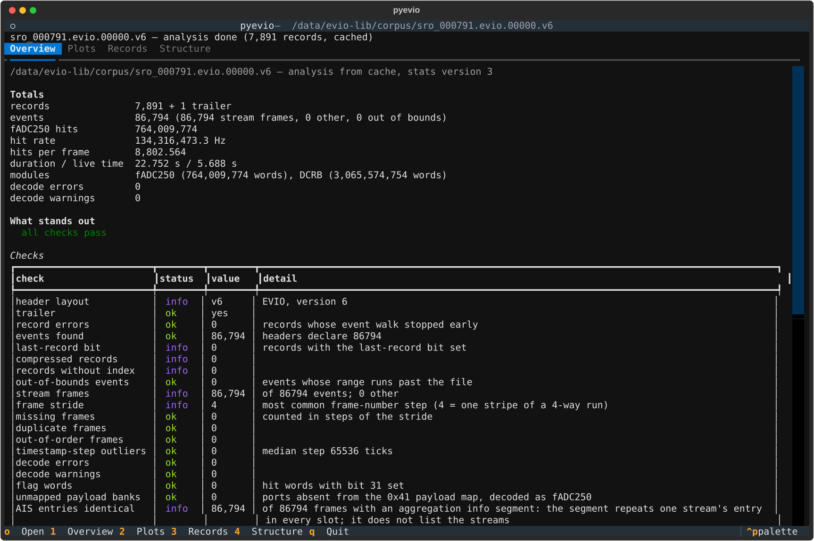
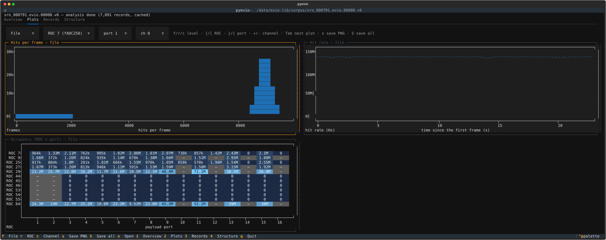
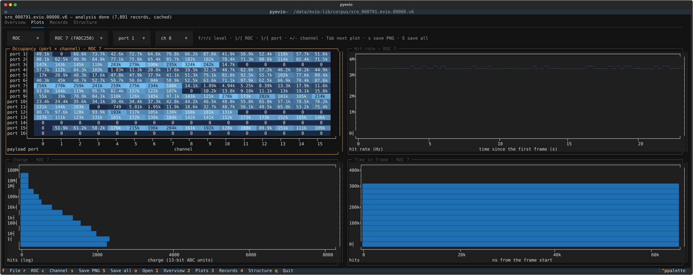
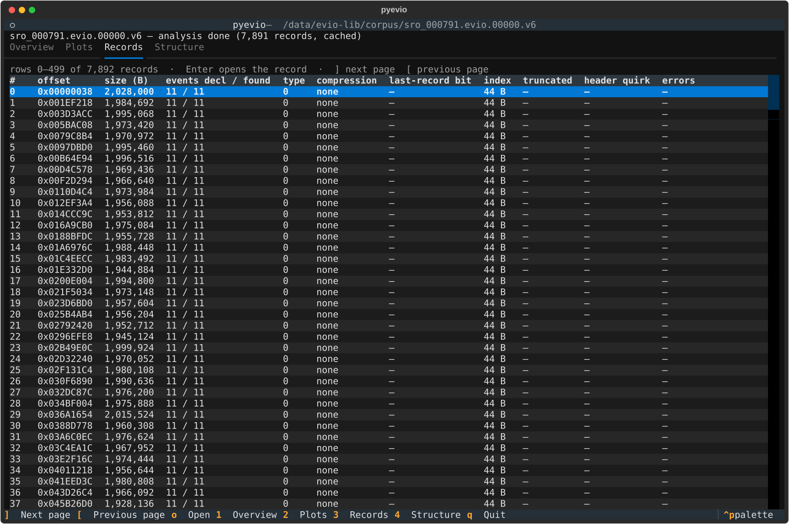
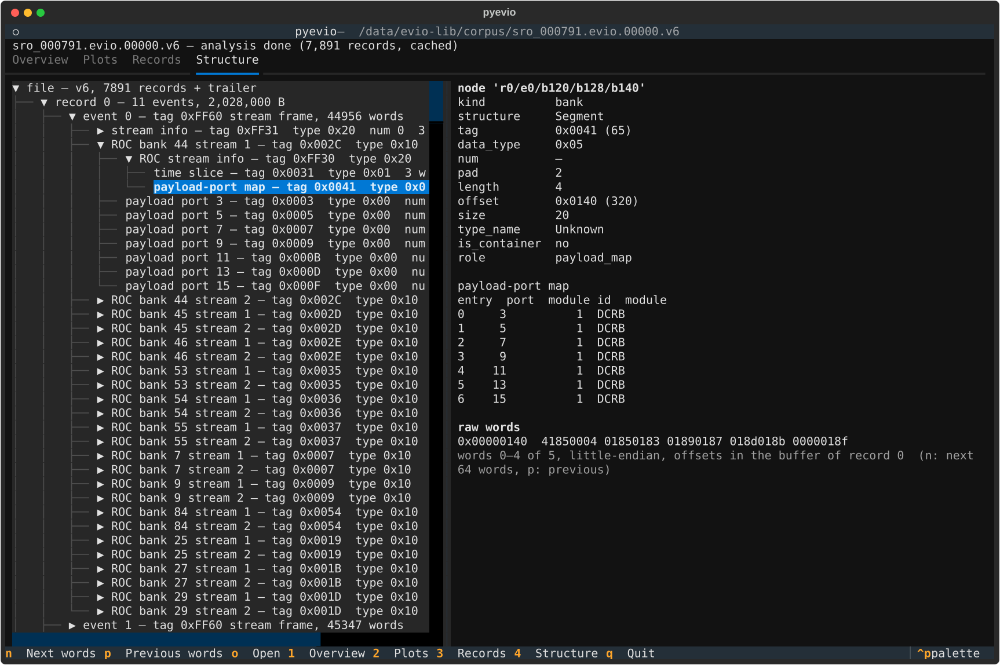

# Console viewer

`pyevio gui` opens the same viewer as [`pyevio web`](web_viewer.md) in the terminal: file checks and totals, channel occupancy, rate, charge and timing plots, a record table and a structure tree from the file header down to single fADC hit words. It is a [Textual](https://textual.textualize.io/) app: no server, no browser, no port to forward, so it runs as it is in an SSH session on the node that holds the file. Both viewers read through the same model functions of `pyevio.web` (`report`, `structure`, `jobs`, `cache`; none of them imports FastAPI) and share the statistics cache, so they show the same numbers for the same file and a file analyzed in one opens at once in the other.

Plots are written for CODA streaming fADC250 files (0xFF60 built time frames). Any other EVIO v6 file shows the record table and the structure tree.

## Install and start

The viewer needs Textual and textual-plotext, installed as the optional extra:

```bash
pip install 'pyevio[gui]'
```

```bash
pyevio gui run.evio              # open a file
pyevio gui                       # pick a file in the current folder
pyevio gui /path/to/runs         # pick a file in another folder
pyevio gui run.evio --workers 8 --cache-dir /scratch/pyevio-cache
```

Without the extra, `pyevio gui` prints `The console viewer needs Textual and textual-plotext: pip install 'pyevio[gui]'` and exits with code 1. The rest of pyevio does not need Textual.

PNG export (`s` and `S` in the Plots tab) uses matplotlib, which the package installs anyway.

### Analysis and cache

Opening a file starts one analysis job (`pyevio stats` on all cores minus two, or `--workers N`) in a background thread; the status line under the header shows the records done, the time left and a progress bar, and the Overview and Plots tabs fill when it finishes. The Records and Structure tabs read the file directly and work while the analysis runs. Opening another file cancels the running job.

Results are cached as `.npz` under `~/.cache/pyevio/stats` (or `--cache-dir DIR`), keyed by the file path, size and modification time, the same cache `pyevio web` writes and reads: a second open of an unchanged file, in either viewer, is immediate, and the status line says `cached`. An entry written by an older statistics version is recomputed and overwritten in place. The cache folder can be deleted at any time.

### Over SSH

Run `pyevio gui` on the node that holds the file; the terminal is all it needs. Textual uses the full terminal size, so a larger window shows more rows, more tree lines and finer plots (see [Limitations](#limitations) for what the plots need). `pyevio gui` has no `--port`, no token and no network interface: it is one process reading one file.

## Keys

The footer lists the keys of the active tab. Everything in the footer also works with the mouse: tabs, the selection boxes of the Plots tab, tree nodes, table rows and scrolling. Ctrl+P opens Textual's command palette.

**Everywhere**

| key | action |
|---|---|
| `o` | open a file (the open screen) |
| `1` `2` `3` `4` | Overview, Plots, Records, Structure |
| `q` | quit |

**Open screen** (`o`, or the start without a file)

| key | action |
|---|---|
| Enter | in the path field: open the typed file, or re-root the tree at the typed folder; in the tree: open the selected file |
| Tab | move between the path field and the tree |
| Backspace | with the tree focused: go to the parent folder (in the path field it deletes a character) |
| Ctrl+A | with the tree focused: list every file, not only EVIO names (in the path field it moves the cursor home) |
| Escape | cancel, keep the current file |

The tree lists folders and files whose names look like EVIO files; dot files are hidden. A file pyevio cannot read (not EVIO, an EVIO v4 file) is refused with the reason in the status line, and the current file stays open.

**Records**

| key | action |
|---|---|
| Up, Down, PageUp, PageDown | move the row cursor; past the last or first row of the page the next or previous page loads |
| `]` `[` | next and previous page of 500 records |
| Enter | open the record in the Structure tab |

**Structure**

| key | action |
|---|---|
| Up, Down | move between tree nodes; the detail panel follows |
| Enter | expand or collapse the node; on a `… N more` row, load the next page of children |
| Space | expand or collapse the node |
| `n` `p` | next and previous window of 64 raw words in the detail panel |

**Plots**

| key | action |
|---|---|
| `f` `r` `c` | file, ROC or channel level |
| `]` `[` | next and previous ROC |
| `}` `{` | next and previous port of the ROC |
| `+` `-` | next and previous channel; past channel 15 the next port's channel 0 follows (`=` also steps forward) |
| Tab | move the focus to the next plot or selection box |
| `s` | save the focused plot (else the first) as a PNG in the working directory |
| `S` | save every plot of the current level |

`]` and `[` page the record table in the Records tab and step the ROC in the Plots tab; the keys of a tab are active only while that tab is shown.

## What it shows

The header names the file; the status line shows the analysis state (`analyzing 1,234 of 7,891 records, 20 s left`, `analysis done (7,891 records, cached)`) and, in red, the last error. Errors also pop up as a notification for a few seconds.

### Overview

Totals (records, events, stream frames, hits, hit rate, hits per frame, duration and live time, modules with their word counts, decode errors and warnings with the first message), "what stands out" (the error and warn checks, then the first decode messages; `all checks pass` otherwise), the checks table with the status coloured, the file facts (header layout, byte order, record counts declared and scanned, trailer position as the file header stores it, the record-scan checks in words) and one row per ROC with its modules, ports, hits, other-module words and empty banks. The pane scrolls; the screenshot shows its top.



### Plots

All histograms come from `pyevio stats`; the pane draws the bins it receives with [plotext](https://github.com/piccolomo/plotext) and rebuilds them on every resize. The row of selection boxes above the plots sets the level, the ROC, the port and the channel; the keys set the same things and the boxes follow.

**File:** hits per frame, total hit rate over time (seconds from the first frame; empty bins are frames without hits or missing frames) and the occupancy heatmap of hits per ROC and payload port. A dash marks a port the ROC's 0x41 map does not list; the counts are printed in the cells when they fit (see [Limitations](#limitations)).



**ROC:** the port × channel occupancy of the ROC, its hit rate over time, charge spectrum and hit time within the frame.



**Channel:** hit rate, charge spectrum and time in frame of one channel; `+` and `-` step through the channels of the ROC port by port.

The heatmap colour ramp is square-root scaled, as in the browser, so a few hot channels do not flatten the rest.

### Records

A paged table of the record headers: index, offset, size, events declared and found, header type, compression, last-record bit, index array, truncation, header quirks and walk errors; problem cells are red, quirks yellow. One page of 500 rows is loaded at a time, so a file of a million records costs one page of strings. The line above the table says which rows are shown; the trailer is the last row of the last page. Enter opens the record in the Structure tab.



### Structure

Left, the tree pyevio builds: file → records and trailer → events → banks and segments → hit words. Children load one page of 500 when a node is expanded; a page short of the total ends with a `… N more (press Enter to load)` row. Inside a stream frame the nodes are labeled by role as in the browser: stream info with its time-slice and aggregation-info (AIS) segments, ROC banks with ROC id and stream, ROC stream info with the payload-port map, payload banks with port, module and hit count, and the decoded hits (`hit 3 — ch 3  t 1232 ns  q 14  <word as eight hex digits>`, with `FLAG` when bit 31 is set). Records with walk errors say so in their label.

Right, the highlighted node: its id, every field of its header, its walk errors in red, the decoded payload-port map when it has one, and a hex dump of its raw words, 64 per window (`n` / `p`), eight per line with the byte offset of the line first. Record headers are read at their file offset; events and banks from their record's buffer, with a note when that buffer is a decompressed LZ4 or gzip record. Hits have fields but no words.



## PNG export

`s` writes the focused plot (the one with the highlighted border; Tab moves it) as a PNG in the current working directory, `S` every plot of the level. The name is the file's stem, the histogram and the selection: `sro_000791.evio.00000_hits_per_frame.png`, `sro_000791.evio.00000_charge_roc7_port1_ch3.png`. A notification shows the path. The PNGs are drawn by matplotlib with the Agg backend, so they work on a node without a display, at the histogram's full binning: the charge spectrum gets a logarithmic y axis, the occupancy a Blues colour map with the square-root scale, the counts in the cells, grey cells for unmapped ports and a colour bar.

## Limitations

- Plots have character resolution: a histogram with more bins than the plot is wide is rebinned to fit (the counts add up, the rate is averaged over the frames of the merged bins), and a plot narrower than 16 columns or lower than 6 rows stays blank. The PNG export keeps every bin.
- The charge spectrum has a linear y axis in the terminal; the PNG uses a logarithmic one, as the browser does.
- The counts in the occupancy heatmap are printed only when every count of the plot fits in its cell with a margin. With 16 ports or channels across and counts in the millions (`10.6M`, five characters) that takes a plot about 125 columns wide, i.e. a terminal of about 260 columns in the 2 × 2 grid; the screenshots above are at 260 × 50. Narrower, the cells show the colour only; the dash of an unmapped port is always shown.
- The detail column of the Structure tab cannot take the focus (a focusable widget inside a hidden tab would pull Textual back to that tab, see `pyevio/gui/structure.py`); it scrolls with the mouse wheel only. The tree and the record table scroll with the keys.
- The step keys of the Plots tab (`]` `[` `}` `{` `+` `-`) are not listed in the footer; the hint line next to the selection boxes lists them.

## Known problems

- The analysis of a file that is not in the cache fails with `ValueError: bad value(s) in fds_to_keep` when it runs with more than one worker (observed with Textual 8.2.8 and Python 3.12): Textual replaces `sys.stderr` while the app runs, and the multiprocessing resource tracker cannot start without a real stderr. Until this is fixed, run `pyevio gui FILE --workers 1` (one process, slower), or analyze the file in `pyevio web` or an earlier `pyevio gui --workers 1` run first: the cache is shared, so the viewer then opens it at once.
