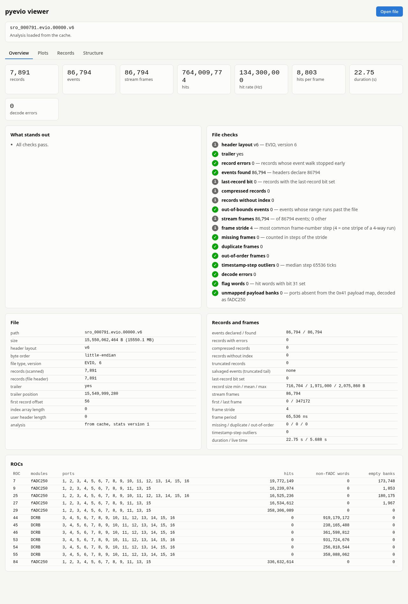
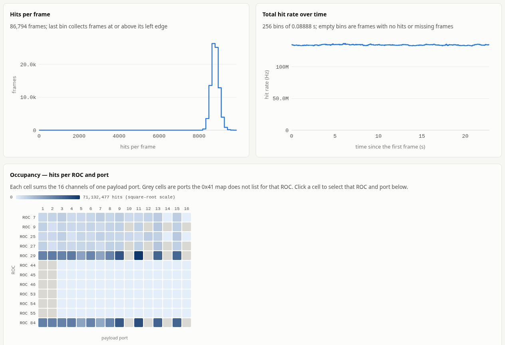
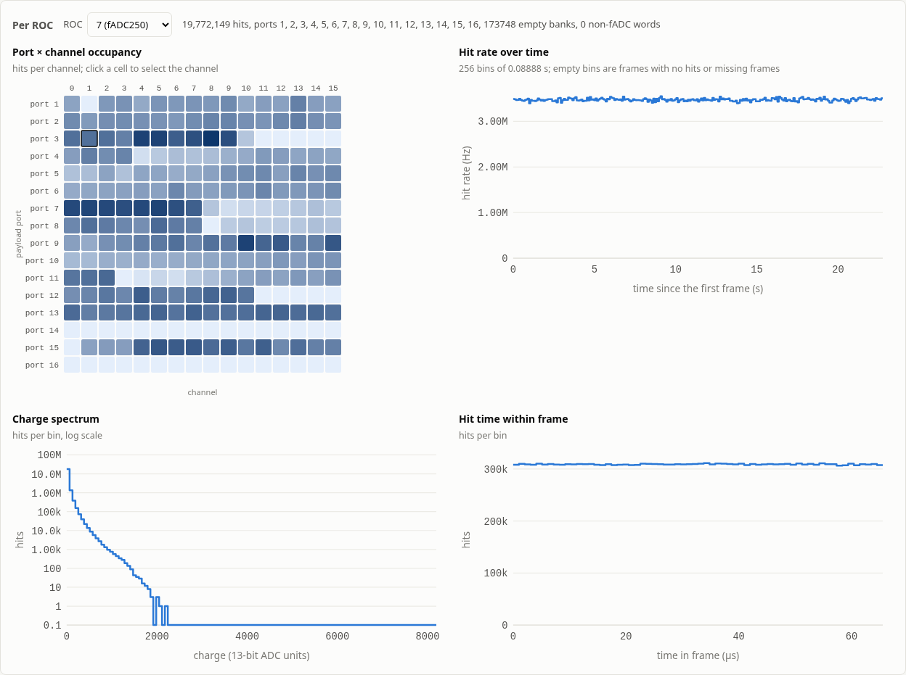
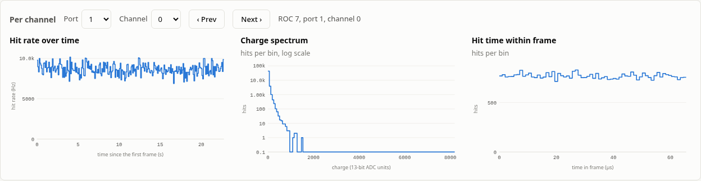
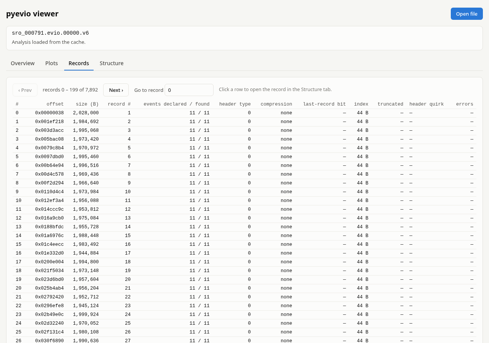
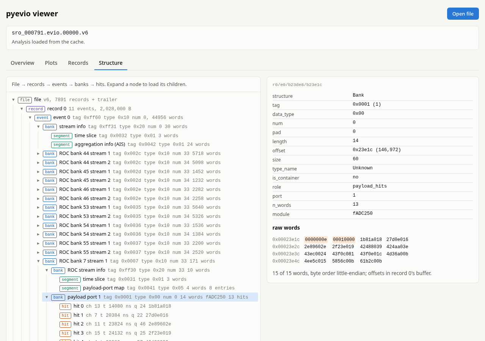

# Web viewer

`pyevio web` opens a page for browsing an EVIO v6 file: file checks, channel occupancy, rate, charge and timing plots, a record table and a structure tree from the file header down to single fADC hit words. pyevio reads and decodes the file on the server; the browser receives JSON (histograms, record headers, tree nodes, requested words) and renders it. The file never leaves the machine it is on, and a 15 GB file produces the same few kilobytes per response as a 90 MB one.

Plots are written for CODA streaming fADC250 files (0xFF60 built time frames). Any other EVIO v6 file shows the record table and the structure tree.

## Install and start

The server needs FastAPI and uvicorn, installed as the optional extra:

```bash
pip install 'pyevio[web]'
```

```bash
pyevio web                       # serve the current folder
pyevio web /path/to/runs         # serve another folder
pyevio web /path/to/runs --port 9000 --no-browser --workers 8 --cache-dir /scratch/pyevio-cache
```

The command prints a URL of the form `http://127.0.0.1:8765/?token=…` and opens it in a browser (unless `--no-browser`). The token is random per start and required on every API request: another user on the same machine cannot read your files by guessing the port. Open the printed URL, including the token; a page without it shows nothing.

Only files under ROOT (the folder given on the command line, default the current folder) can be listed and opened. Paths are resolved with symlinks before the check, so a link that points outside ROOT is refused.

### Analysis and cache

Opening a file starts one analysis job on the server (`pyevio stats` on all cores minus two, or `--workers N`); the page shows its progress and the estimated time to completion. Opening another file cancels the running job. Results are cached as `.npz` under `~/.cache/pyevio/stats` (or `--cache-dir DIR`), keyed by the file path, size, modification time and the statistics version, so a second open of an unchanged file is immediate. The cache folder can be deleted at any time.

### Files on a remote machine

On a farm node, run the server there and forward the port over SSH:

```bash
# on the node
pyevio web /path/to/runs --no-browser
# on your machine
ssh -L 8765:localhost:8765 user@node
```

Then open the URL the server printed on the node, token included, in a local browser. The server listens on 127.0.0.1 only and rejects requests whose `Host` header is not `localhost` or `127.0.0.1`, which also blocks web pages that reach the port through DNS rebinding.

`--verbose` logs every request; by default only errors are logged.

## What it shows

The page is five static files (`index.html`, `style.css`, `app.js`, `charts.js`, `tree.js`) served by the package; no build step and no external resources, so it works on a farm node without internet. Pick a file in the folder browser at the top; the status strip shows the analysis progress (records done, time left) and the tabs enable when the analysis is done. Opening another file cancels the running analysis and switches the page to the new file. Errors from the server (a file that is not EVIO, a failed analysis, a lost connection) appear in red under the status line.

### Overview

Totals (records, events, stream frames, hits, hit rate, hits per frame, duration, decode errors), the file checks with their status, "what stands out" (the failed and warning checks first), the file facts (header layout, byte order, trailer position as the file header stores it, salvaged events of a truncated tail) and one row per ROC. Ratios with a zero denominator print as `n/a`.



### Plots

All histograms are computed by `pyevio stats` on the server; the browser draws the bins it receives.

**File:** hits per frame, total hit rate over time (seconds from the first frame; empty bins are frames without hits or missing frames) and an occupancy heatmap of hits per ROC and payload port. Grey cells are ports the ROC's 0x41 map does not list.



**Per ROC:** pick a ROC (or click a cell in the occupancy map): its port × channel occupancy, hit rate over time, charge spectrum and hit time within the frame.



**Per channel:** pick port and channel, step with Prev / Next, or click a cell in the ROC map.



### Records

A paged table of the record headers: offset, size, events declared and found, header type, compression, last-record bit, index, truncation, header quirks and walk errors. Click a row to open the record in the Structure tab.



### Structure

The tree pyevio builds: file → records → events → banks and segments → hit words, loaded as nodes are expanded (pages of 500 children). Inside a stream frame the nodes are labeled by role: stream info with its time-slice and aggregation-info (AIS) segments, ROC banks with ROC id and stream, ROC stream info with the payload-port map (its entries decoded by pyevio), payload banks with port, module and hit count. Selecting a node shows its header fields and its raw words; events of LZ4 or gzip records are read from the decompressed record buffer.



## Data format

The stream format (0xFF60 built time frames, 0xFF31/0xFF30 stream-info banks, the 0x41 payload-port map, the hit word `t = bits[30:17] × 4 ns, ch = bits[16:13], q = bits[12:0]`) is decoded in one place, `pyevio/decoders/fadc250_stream.py`; the viewer holds no copy of it. See [stream_decoding.md](stream_decoding.md).

## Convert to Parquet

[examples/fadc250_stream_to_parquet.py](../examples/fadc250_stream_to_parquet.py) decodes the same hits with pyevio and numpy into two Parquet tables, for analysis outside the browser (requires `pip install pyarrow`):

```bash
python examples/fadc250_stream_to_parquet.py run.evio   # → out/run.hits.parquet, out/run.frames.parquet
```

Hits (`frame, roc, port, ch, t_ns, q`) are sorted by `(frame, t_ns)`. Rows `hit_offset … hit_offset + n_hits` of the hits table belong to that frame.
